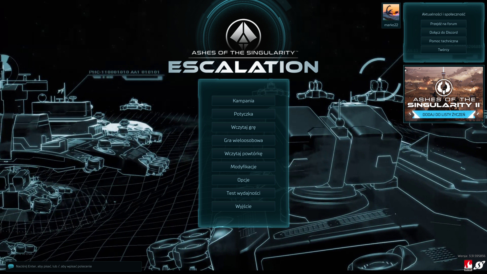
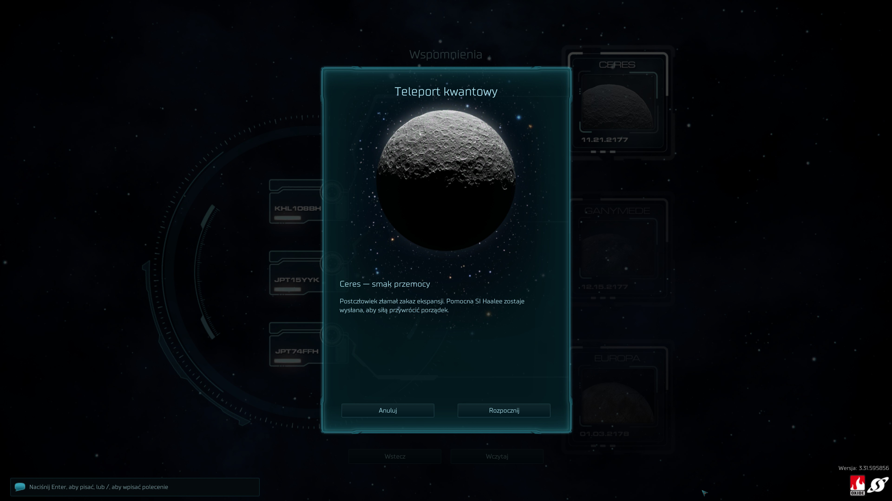
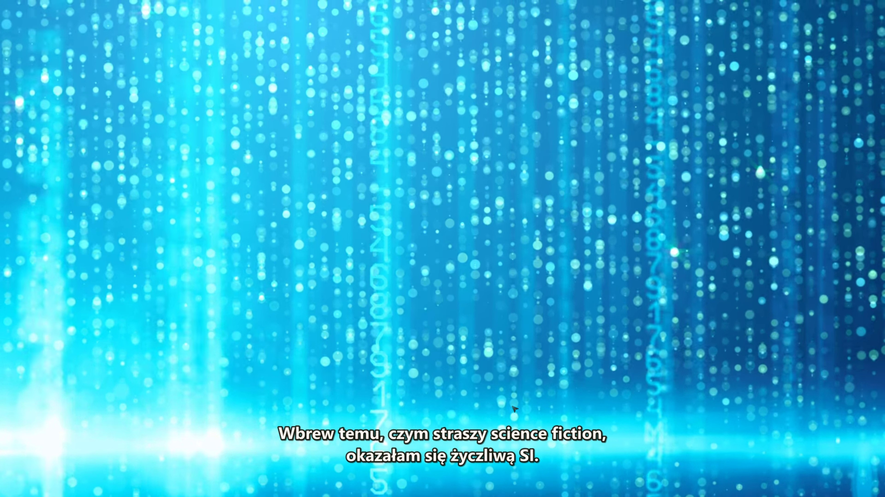
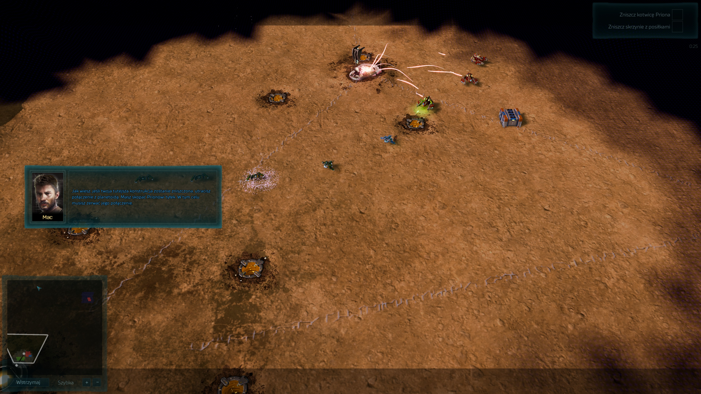
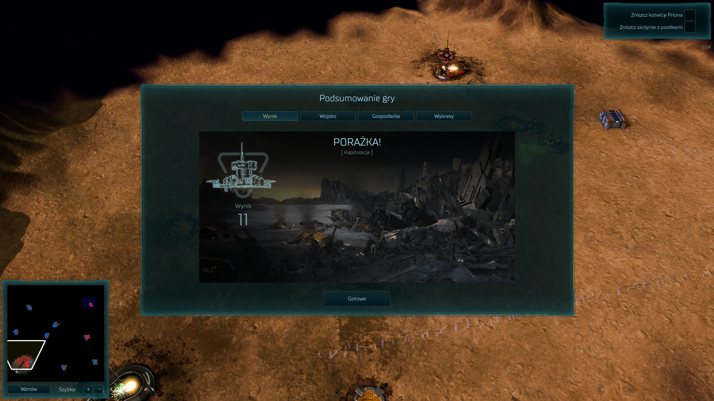
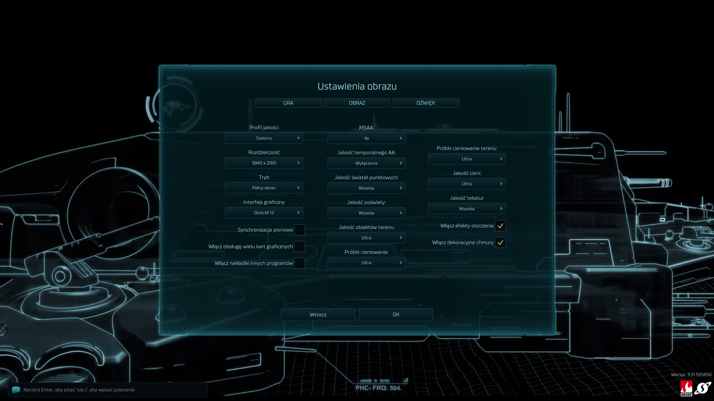

# Ashes of the Singularity: Escalation — Spolszczenie PL

Fanowska polska lokalizacja gry, autorstwa **marko22**.

## 📦 Aktualne wydanie

**v1.0.0** · 24.11.2026 · Windows / Steam · DirectX 11 i DirectX 12

➡️ [Pobierz najnowszą wersję](https://github.com/mariuszm22/Ashes-of-the-Singularity-Escalation-Spolszczenie-PL/releases/tag/v1.0.0)

- [EXE — instalator automatyczny](https://github.com/mariuszm22/Ashes-of-the-Singularity-Escalation-Spolszczenie-PL/releases/download/v1.0.0/Ashes_Escalation_PL_Setup.exe) · 10,80 MB
- [ZIP — instalacja ręczna](https://github.com/mariuszm22/Ashes-of-the-Singularity-Escalation-Spolszczenie-PL/releases/download/v1.0.0/Ashes_Escalation_PL_1.0.0.zip) · 4,23 MB
- [Dodatki — 24 opcjonalne polskie filmy](https://downloads.marko22.pl/ashes-escalation/1.0.0/Ashes_Escalation_PL_Filmy_1.0.0.pack) · 7,40 GB
- [Sumy SHA-256](https://github.com/mariuszm22/Ashes-of-the-Singularity-Escalation-Spolszczenie-PL/releases/download/v1.0.0/SHA256SUMS.txt)

## Windows SmartScreen / instalator EXE

Windows może wyświetlić komunikat SmartScreen przy uruchamianiu EXE bez komercyjnego podpisu cyfrowego. Sumę pobranego pliku możesz porównać z dołączonym spisem SHA-256. Dostępna jest również instalacja ręczna z ZIP.

## 📷 Zrzuty ekranu

## 📋 Zawartość tłumaczenia

- 5 209 zlokalizowanych rekordów i 38 758 słów tekstu źródłowego.
- Polskie menu, interfejs, dialogi, cele, opisy misji oraz 90 porad ładowania.
- Trzy zmodyfikowane czcionki i zlokalizowane elementy graficzne.
- 24 opcjonalne filmy z polskimi dialogami w obrazie lub napisami. Oryginalne ścieżki dźwiękowe są zachowane.

**Zgodność:** wersja Steam dla Windows, DX11 i DX12. Wymagana jest własna kopia gry.

## ⚙️ Instalacja

1. Zamknij grę i uruchom **Ashes_Escalation_PL_Setup.exe**.
2. Wybierz **Zainstaluj lub napraw spolszczenie**. Zatwierdź wykryty folder Steam lub wskaż go ręcznie.
3. Jeśli wybierasz filmy, umieść pobraną paczkę obok instalatora lub wskaż ją ręcznie. Możesz doinstalować filmy później tym samym kreatorem.
4. Sprawdź podsumowanie i kliknij **Zainstaluj**.

Uruchom grę przez Steam i upewnij się, że w ustawieniach języka wybrano **English (angielski)**. Ze względu na ograniczenia silnika gry spolszczenie zastępuje język angielski.

Przy [instalacji ręcznej](https://github.com/mariuszm22/Ashes-of-the-Singularity-Escalation-Spolszczenie-PL/releases/download/v1.0.0/Ashes_Escalation_PL_1.0.0.zip) wypakuj ZIP do osobnego folderu i wykonaj kroki z **README_PL.txt**. [Pełna instrukcja instalacji](INSTALACJA.md).

## 🗑️ Deinstalacja

Przy zamkniętej grze użyj opcji **Odinstaluj całe spolszczenie** w kreatorze. Jeśli instalowałeś ręcznie, wyłącz mod marko22 i odtwórz pliki według instrukcji ZIP.

## 🐞 Zgłaszanie błędów

Użyj [GitHub Issues](https://github.com/mariuszm22/Ashes-of-the-Singularity-Escalation-Spolszczenie-PL/issues). Podaj miejsce wystąpienia problemu i w miarę możliwości dołącz zrzut ekranu.

## ⚠️ Informacja

[Strona projektu i galeria](https://marko22.pl/ashes-escalation) · [Pobieranie na marko22.pl](https://marko22.pl/pobieranie#ashes-escalation) · [Gra na Steam](https://store.steampowered.com/app/507490/)

Autor spolszczenia i redakcja: **marko22**. Projekt fanowski. Prawa do gry i jej grafiki należą do ich właścicieli.

## 🎮 Miłej gry!
